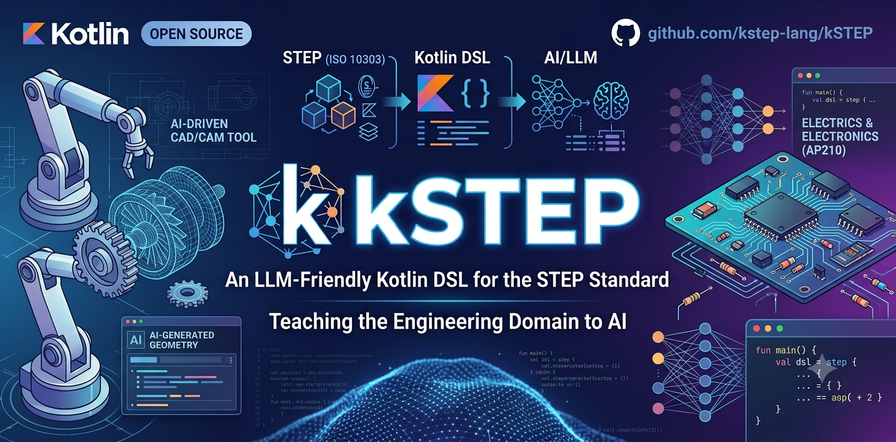

= kSTEP

Type-safe Kotlin DSL for the STEP standard (ISO 10303).

image:https://img.shields.io/badge/Kotlin-2.4.10-7F52FF.svg?logo=kotlin&logoColor=white[Kotlin 2.4.10,link=https://kotlinlang.org]
image:https://img.shields.io/badge/JDK-21+-ED8B00.svg?logo=openjdk&logoColor=white[Java 21+,link=https://adoptium.net]
image:https://img.shields.io/github/license/kstep-lang/kSTEP[Apache 2.0,link=https://github.com/kstep-lang/kSTEP/blob/master/LICENSE]
image:https://github.com/kstep-lang/kSTEP/actions/workflows/ci.yml/badge.svg?branch=master[CI,link=https://github.com/kstep-lang/kSTEP/actions/workflows/ci.yml]

WARNING: kSTEP is in early, pre-release development (M2). The API is
unstable and nothing is published to Maven Central or Homebrew yet; tagged releases
(https://github.com/kstep-lang/kSTEP/releases[GitHub releases], see
link:CHANGELOG.adoc[CHANGELOG]) are pre-releases: v0.1.0 is source-only, from
v0.1.1 on a JVM-only CLI zip without native bridges is attached. See
link:docs/status.adoc[Status] for what actually works today.

Licensed under the Apache License, Version 2.0. See link:LICENSE[LICENSE].

== Why kSTEP

LLMs are strong in popular, high-resource languages (Kotlin, Java, Python)
but measurably weak at generating external, low-resource DSLs — and STEP's
native exchange format (Part 21, graphs of `#123`-style entity references)
is a particularly hostile one to read or write directly.

kSTEP applies **Typed Domain Grounding (TDG)** — the pattern already
validated by its sibling project, https://github.com/kuml-dev/kUML[kUML]:
expose a domain as a type-safe, embedded Kotlin DSL with semantic
validation and structured errors, so that both human developers and LLM
agents can work in it reliably. The syntax stays Kotlin (high-resource);
only the vocabulary is domain-specific, enforced by the type system. A
strict type system, a compiler, and structured validation errors form a
feedback loop the LLM can act on directly, without a separate benchmark
or fine-tuning step. kSTEP compiles that DSL down to the neutral,
standardized ISO 10303 exchange format.

== Vision

kSTEP is not "just another CAD tool." The ambition is to cover the
**entire STEP standard (ISO 10303)**: CAD is the entry point, not the
boundary. STEP also spans manufacturing (STEP-NC), electrical and
electronics, kinematics, composites, FEM/simulation and plant/process data,
each carved out as its own Application Protocol (AP242, AP238, AP210, AP209,
and others). Those APs are the building blocks kSTEP intends to grow into.

It is the deliberate third way between classic, GUI-centric CAD suites and
niche code-first CAD: code-first, AI-first and STEP-native instead of
proprietary. It is the same thesis as its sibling project
https://github.com/kuml-dev/kUML[kUML] in the UML/SysML space, applied to the
engineering domain.

V1 deliberately starts narrow: a single Application Protocol (AP242), scoped
down to product structure and metadata (see
link:docs/roadmap.adoc[Roadmap] and kSTEP-ADR-0001). Geometry was added
afterwards as an optional layer.

== Status

The current release is **v0.3.0** (2026-10-24), a pre-release; changes on
the `master` branch after it are listed under "Unreleased" in the
link:CHANGELOG.adoc[CHANGELOG]. What is in place:

* EXPRESS parser, semantic model and Kotlin code generation, with an
  AP242 V1 entity layer (`kstep-core`) and STEP Part 21 export/import.
* A Kotlin scripting host for `*.kstep.kts` files, the `kstep` command-line
  tool (`export`, `import`, `render`, `asciidoc`, `mcp`) and an MCP server.
* Optional geometry: an OpenCascade (OCCT) bridge (primitives, booleans, holes,
  fillet/chamfer, mirror, uniform scale, shell, edge/face/vertex selection,
  persistent edge names, a feature history with undo/redo), a PlaneGCS sketch
  solver, placed assemblies, colours and layers in export and import, and
  headless preview rendering. Both native bridges need system libraries
  (Linux x86-64 or macOS arm64) and are not part of the release zip.

Pocket/hole from a face, draft and thickening are on the unreleased master (Welle Q2, ADR-0040).

Not yet available: PMI, names for the faces these create, Windows
and Intel Mac support for the native bridges, and interoperability checks
beyond OpenCascade-based readers (OCCT, FreeCAD).

The wave-by-wave log is in link:docs/status.adoc[Status]; open points are in
the link:docs/roadmap.adoc[Roadmap]. Both say what is and is not verified.

== Quickstart

Requires JDK 21. Build the command-line tool and export a product structure
to a STEP Part 21 file (the native geometry bridges are optional and not
needed for this):

[source,shell]
----
./gradlew clean :kstep-cli:installDist
----

Save this script as `bracket.kstep.kts`:

[source,kotlin]
----
val appCtx = applicationContext { application = "config control" }.getOrThrow()
val prodCtx = productContext {
    name = "engineering"; frameOfReference = appCtx; disciplineType = "mechanical"
}.getOrThrow()
val defCtx = productDefinitionContext {
    name = "engineering"; frameOfReference = appCtx; lifeCycleStage = "design"
}.getOrThrow()

val bracket = product("BRK-001") { name = "Bracket"; frameOfReference = setOf(prodCtx) }.getOrThrow()
val bracketFormation = productDefinitionFormation("BRK-001-F") { ofProduct = bracket }.getOrThrow()
val definition = productDefinition("BRK-001-D") {
    formation = bracketFormation
    frameOfReference = defCtx
}.getOrThrow()

stepFile(fileName = "bracket.step") {
    root(definition)
}
----

[source,shell]
----
kstep-cli/build/install/kstep-cli/bin/kstep-cli export bracket.kstep.kts
# Exported 1 root(s) to bracket.step
----

The installed launcher is named `kstep-cli`; the documentation calls the
command `kstep`. The same pipeline as a library, parsing an EXPRESS schema and
generating Kotlin source:

[source,kotlin]
----
import dev.kstep.express.codegen.ExpressKotlinCodeGenerator
import dev.kstep.express.semantic.ExpressSemanticModelBuilder

val schema = """
    SCHEMA example_schema;
      ENTITY product;
        id   : STRING;
        name : STRING;
      END_ENTITY;
    END_SCHEMA;
""".trimIndent()

val model = ExpressSemanticModelBuilder.build(schema)
println(
    ExpressKotlinCodeGenerator.generateFileSource(
        model.schemas.single(),
        "dev.kstep.generated.example",
    ),
)
// package dev.kstep.generated.example
//
// import kotlin.String
//
// public data class Product(
//   public val id: String,
//   public val name: String,
// )
----

More examples (validation, geometry, sketches, rendering, import) are in
link:docs/usage.adoc[Usage].

== Modules

[cols="1,3",options="header"]
|===
| Module | Purpose

| `kstep-core`
| Core DSL types, validation results and the generated AP242 V1 entity classes.

| `kstep-express`
| ANTLR4 EXPRESS parser, semantic model and Kotlin code generator.

| `kstep-step21`
| STEP Part 21 reader and writer for the AP242 entities.

| `kstep-script`
| Kotlin scripting host for `*.kstep.kts` scripts.

| `kstep-cli`
| Command-line entry point.

| `kstep-mcp`
| MCP server exposing the entity builders and Part 21 export as LLM tools.

| `kstep-geometry`
| Optional OpenCascade (OCCT) JNI bridge for B-Rep geometry.

| `kstep-constraints`
| Optional PlaneGCS bridge for 2D geometric constraints.

| `kstep-sketch`
| Constraint-sketch DSL.

| `kstep-shape`
| AP242 shape assignment: merges product structure with B-Rep solids.

| `kstep-render`
| Headless mesh projection and SVG/PNG/text/glTF rendering.

| `kstep-preview`
| Shared headless preview pipeline behind `render` and `asciidoc`.

| `kstep-docs:kstep-asciidoc`
| Asciidoctor pre-processing integration (`kstep asciidoc`).

| `kstep-viewer`
| Interactive OCCT shape viewer (Compose Desktop).

| `kstep-tests`
| Cross-module integration tests (Kotest).
|===

Details per module: link:docs/modules.adoc[Modules].

== Documentation

[cols="1,3",options="header"]
|===
| Document | Contents

| link:docs/status.adoc[Status] | Wave-by-wave status log of what works and what is verified.
| link:docs/modules.adoc[Modules] | Per-module reference.
| link:docs/building.adoc[Building] | Build, CI, and the optional OCCT, PlaneGCS, viewer and validator setups.
| link:docs/releasing.adoc[Releasing] | How a release is cut.
| link:docs/usage.adoc[Usage] | Library and CLI usage, MCP server, scripts, colours and layers in the export.
| link:docs/usage-sketches.adoc[Usage: sketches] | Sketches and edge selection.
| link:docs/usage-naming.adoc[Usage: naming] | Persistent edge naming, undo/redo.
| link:docs/usage-mirror-scale-shell.adoc[Usage: mirror, scale, shell] | Mirror, scale, face and vertex selection, shell.
| link:docs/usage-import.adoc[Usage: import] | Reading a STEP file back.
| link:docs/roadmap.adoc[Roadmap] | V1 scope and open points.
| link:CHANGELOG.adoc[CHANGELOG] | Release history.
| link:docs/adr/[Architecture decisions] | The ADRs.
|===

NOTE: Source comments and error messages written before this split refer to
the README sections "Building", "Status", "Usage" and "Roadmap". They now live
in the files above, for example "README 'Building'" is
link:docs/building.adoc[docs/building.adoc].

== License and attribution

kSTEP is licensed under the Apache License, Version 2.0 — see
link:LICENSE[LICENSE].

The bundled EXPRESS grammar
(`kstep-express/src/main/antlr/dev/kstep/express/grammar/Express.g4`)
is vendored from https://github.com/lutaml/express-grammar[lutaml/express-grammar]
and is BSD-2-Clause licensed (Ribose Inc.); see link:NOTICE[NOTICE] for
full attribution.

A small excerpt of the real AP242 EXPRESS schema
(`kstep-express/src/main/resources/dev/kstep/express/codegen/ap242-v1-entities.exp`
— nineteen declarations, mostly verbatim (two spots deliberately
adapted), not the complete 2,122-entity schema) is copied from
the official CAx-IF/MBx-IF-published `ap242ed2_dis2_mim_lf_v1.101.exp`
(ISO TS 10303-442 AP242 EXPRESS MIM Long Form, v1.101, 2019); see
link:NOTICE[NOTICE] for full provenance, which parts are verbatim vs.
adapted, and the precedent this rests on.

`kstep-mcp` depends on the official
https://github.com/modelcontextprotocol/kotlin-sdk[Model Context Protocol
Kotlin SDK] (`io.modelcontextprotocol:kotlin-sdk-server`, maintained by
Anthropic in collaboration with JetBrains), which is MIT licensed —
compatible with kSTEP's Apache 2.0 license, not vendored or modified,
pulled in as a normal Gradle dependency.

`kstep-geometry`'s native JNI shim
(`kstep-geometry/src/main/cpp/kstep_occt_bridge.cpp`) is compiled, at
build time only, against a system-installed
https://dev.opencascade.org[Open CASCADE Technology (OCCT)] library
(Ubuntu package `libocct-*-7.9`), licensed under LGPL-2.1-only with the
Open CASCADE Exception 1.0 — see
https://dev.opencascade.org/resources/licensing. No OCCT binary, header,
or source is vendored in this repository, and this product does not
currently bundle or redistribute any OCCT binary; see link:NOTICE[NOTICE]
and `docs/adr/ADR-0005-occt-jni-bridge.adoc` for the full license and
provenance discussion.
